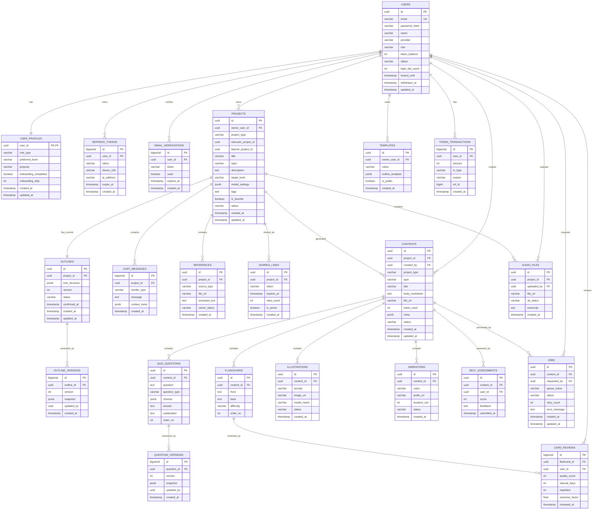
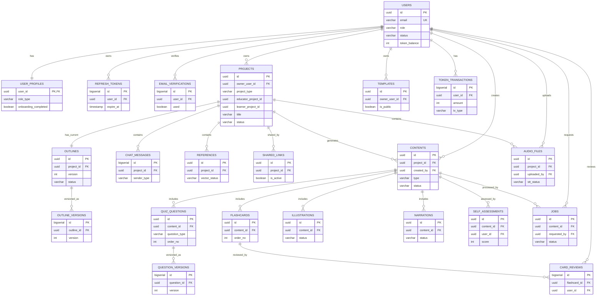

# EduGen ER 다이어그램

**EduGen**(AI 수업자료 생성 플랫폼) 팀 프로젝트의 데이터베이스 설계도입니다. Mermaid로 그려서 GitHub에서 바로 그림으로 보입니다.

| 항목 | 내용 |
| --- | --- |
| 프로젝트 | 교사가 주제와 참고자료(PDF)를 넣고 AI와 대화하며 수업 뼈대를 잡으면, PPT·퀴즈·요약노트·활동지를 만들어 학습자에게 공유하는 서비스 |
| 팀 | 핫소스팀 4인 (2026.04 융합 프로젝트로 시작) |
| 수상 | 2026 안성시 대학생 창업아이템 경진대회 우수상 · 제10회 벤처창업아이템 경진대회 장려상 |
| 이 그림 | **2026년 봄 설계 단계 ERD (v2)**. 테이블 22개 |
| 코드 | 비공개. 팀 원본 저장소에서 함께 개발했고, 2026년 10월부터 통합 저장소(edugen-next)에서 이어 개발(PR 101건) |
| 포트폴리오 | [김도겸의 포트폴리오](https://iced-tarsier-455.notion.site/350af40f5e6680d19f93f1653925a3b8) |

설계안이라 실제 구현과 다른 곳이 있습니다. 무엇이 바뀌었는지는 아래 [설계안과 실제 구현](#설계안과-실제-구현)에 정리했습니다.

## 전체 ER (상세)

## 발표용 ER (PK·FK·핵심 필드)

상세 스키마는 위 블록 참고. 슬라이드·한눈에 보기용으로 관계와 대표 필드만 남김.

## 브라우저에서 미리보기

1. **`preview/er-preview.html`** 파일을 더블클릭하거나, 브라우저로 드래그해서 엽니다. (인터넷이 있어야 Mermaid CDN을 불러옵니다.)
2. `README.md`의 Mermaid를 고친 뒤 미리보기를 다시 만들려면, 이 폴더에서 터미널로 `python gen_preview.py`를 실행합니다.

온라인에서만 보려면 [Mermaid Live Editor](https://mermaid.live)를 열고, README에서 **mermaid**로 시작하는 코드 블록 전체를 복사해 붙여 넣으면 됩니다.

## 설계안과 실제 구현

2026년 11월 기준으로 실제 서비스 코드와 비교한 결과입니다. 기능이 늘면서 실제 DB는 테이블이 45개가 되었고, 설계안과는 다음이 달라졌습니다.

| 설계안 | 실제 구현 |
| --- | --- |
| 프로젝트 하나(PROJECTS)에 교사용·학습자용을 함께 담음 | 교사가 만든 수업만 두고, 학습자는 공유 링크·초대로 자료를 받아 응시·복습 |
| 퀴즈 문항·플래시카드를 각각 테이블로 (QUIZ_QUESTIONS, QUESTION_VERSIONS, FLASHCARDS) | 생성된 자료의 판(버전) 안에 함께 저장하고, 응시 결과·복습 진도만 따로 기록 |
| 사용자 프로필(USER_PROFILES)을 따로 | 사용자 테이블에 합침 |
| 템플릿(TEMPLATES), 녹음 파일·받아쓰기(AUDIO_FILES) | 만들지 않음 |
| 그림(ILLUSTRATIONS) | 슬라이드 사진 저장소로 바뀜 (출처·라이선스까지 기록) |
| 해설 음성(NARRATIONS) | 발표 해설로 구현 (장마다 대본, 목소리별 음성 파일) |
| 생성 작업(JOBS) | 작업 큐에 더해, AI 호출마다 모델·토큰·비용을 기록 |
| `REFERENCES` 테이블 | SQL 예약어라 이름을 바꿈 |
| (설계에 없음) | 소셜 로그인, 비밀번호 재설정, 알림, 크레딧 결제, AI 대화 기록, 의견 보내기 등이 구현하면서 추가됨 |
